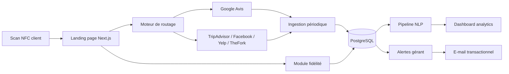

# Architecture technique — Avisio

## 1. Vue d'ensemble



Un seul back-end mutualisé sert les quatre axes. Les modules ne sont pas des
services déployés séparément — ce serait une complexité non financée à ce stade —
mais des **frontières logiques nettes** : chacun peut être extrait sans toucher
aux autres quand le volume l'exigera.

## 2. Découpage du code

```
packages/core/          Domaine pur, aucune dépendance externe
  pricing.ts            Catalogue, devis, droits par offre
  routing.ts            Moteur de routage multi-plateformes
  compliance.ts         Garde-fous réglementaires exécutables
  reviews.ts            Métriques, SLA de réponse, cycle de vie d'un avis
  nlp.ts                Prompts, parsing défensif, moteur heuristique de repli
  trends.ts             Détection de tendance thématique
  benchmark.ts          Comparaison sectorielle anonymisée (k-anonymat)
  loyalty.ts            Barème de points, carence, paliers
  i18n.ts               Négociation de langue et messages de la landing
  ids.ts                Slugs de plaquette, contrôle de capacité NTAG213

apps/api/               API REST Fastify
  repository/           Port de persistance + adaptateurs mémoire et Prisma
  services/             Connecteurs Google, Claude, e-mail, ingestion, analytics
  routes/               public (NFC, fidélité, widget), auth, catalogue, gérant
  prisma/schema.prisma  Modèle de données PostgreSQL

apps/web/               Next.js
  app/s/[slug]/         Landing NFC, rendue côté serveur
  app/dashboard/        Espace gérant
  app/widget/[id]/      Widget avis embarquable
  app/page.tsx          Site vitrine + simulateur de devis
```

### Pourquoi un paquet `core` séparé

Trois raisons concrètes :

1. **Un seul barème.** Le simulateur de devis du site public et la facturation
   appellent la même fonction `quote()`. Le prix annoncé en rendez-vous est le
   prix facturé, par construction.
2. **Les règles de conformité sont testables isolément**, sans base ni réseau.
   Les 89 tests du domaine tournent en moins d'une seconde.
3. **Le front réutilise le domaine.** Le simulateur tourne entièrement dans le
   navigateur, sans appel API.

## 3. Le port de persistance

`apps/api/src/repository/types.ts` définit l'interface que le domaine connaît.
Deux implémentations :

| Adaptateur | Quand | Caractéristiques |
|---|---|---|
| `memory` | `DATABASE_URL` absente | Jeu de démonstration chargé au boot, données volatiles, zéro dépendance |
| `prisma` | `DATABASE_URL` présente | PostgreSQL, index de production, contraintes d'unicité |

Ce n'est pas une astuce de test : c'est ce qui permet de **faire une démonstration
commerciale sur un ordinateur portable sans Docker, sans base et sans réseau**,
avec le même code que la production. L'API annonce son mode au démarrage :

```
Avisio API — persistance: mémoire (démo) · LLM: heuristique locale · Google: simulé · email: console
```

Chaque requête du port porte l'identifiant d'établissement : c'est la frontière
de cloisonnement multi-locataire, revérifiée dans chaque route par `assertAccess`.

### Note sur le typage du client Prisma

Le client est chargé dynamiquement et typé par une interface structurelle
minimale, parce que `@prisma/client` n'est typé qu'après `prisma generate`, qui
exige une `DATABASE_URL`. Avec ce découplage, `tsc` et la suite de tests tournent
sur une machine qui n'a jamais vu la base. Le compromis est assumé : on perd la
vérification statique des requêtes Prisma, on gagne une chaîne de build qui ne
dépend pas d'une base accessible.

## 4. Modèle de données

Huit tables, définies dans `apps/api/prisma/schema.prisma`.

| Table | Rôle | Points d'attention |
|---|---|---|
| `managers` | Comptes de l'espace gérant | Relation N-N avec les établissements (chaînes) |
| `establishments` | Établissements | Index `(secteur, code postal)` et `(NAF, code postal)` pour le benchmark |
| `platform_links` | Une ligne par plateforme activée | Unicité `(établissement, plateforme)` ; porte les compteurs du routage |
| `nfc_tags` | Plaquettes | `slug` unique — une plaquette imprimée qui pointe ailleurs est irrattrapable |
| `scan_events` | Un scan = une ligne | Index `(établissement, date)` pour les courbes |
| `reviews` | Avis ingérés | **Unicité `(établissement, plateforme, id externe)` : c'est elle qui rend l'ingestion idempotente** |
| `alerts` | Alertes gérant | Déduplication des alertes de tendance par titre et fenêtre |
| `loyalty_members` | Membres fidélité | **Aucune coordonnée en clair** : seul un condensat est stocké |

Le résultat du pipeline NLP est dénormalisé dans `reviews` (sentiment, thèmes,
mots-clés) plutôt que dans une table jointe : le dashboard le lit à chaque
chargement, une jointure sur ce chemin chaud ne se justifie pas.

## 5. Le moteur de routage

Le problème : envoyer chaque client vers **une seule** plateforme, celle qui
équilibre le mieux la présence en ligne de l'établissement.

```
déficit(p) = part_cible(p) − part_actuelle(p)
part_actuelle(p) = (avis_connus(p) + scans_routés_depuis_la_dernière_synchro(p)) / total
```

La plateforme au plus fort déficit gagne le scan. Deux détails qui comptent :

- **Les scans déjà routés comptent comme des avis en attente.** Sans ça, entre
  deux synchronisations de compteurs, tout le flux partirait sur la même
  plateforme et la sur-corrigerait massivement.
- **Quand aucune API de lecture n'existe** (TheFork), le compteur d'avis reste à
  zéro et l'algorithme se réduit naturellement à une rotation par scans. Pas de
  branche spéciale à maintenir.

Les parts cibles par secteur (`SECTOR_TARGET_SHARES`) traduisent où les clients
cherchent réellement l'information : Google domine partout, TripAdvisor et
TheFork pèsent sur la restauration et l'hôtellerie, Facebook sur le commerce de
proximité.

**Aucune information sur le client n'entre dans la décision** — ni note
pressentie, ni profil. La signature de `selectPlatform` ne l'accepte pas, et un
test le vérifie.

## 6. Ingestion et traitement des avis

```
Toutes les 20 min, par établissement et par plateforme activée :
  1. fetchReviews(depuis le dernier avis connu)
  2. upsertMany()          → ne renvoie que les avis réellement nouveaux
  3. llm.analyze()         → sentiment, thèmes, mots-clés (JSON strict)
  4. shouldAlert(≤ 3★)     → création d'alerte + e-mail si le droit est actif
  5. fetchCounters()       → resynchronise les compteurs du routage
```

**Idempotence** : la clé `(établissement, plateforme, id externe)` garantit qu'un
avis n'entre qu'une fois, même si deux cycles se chevauchent ou si le processus
redémarre au milieu.

**Pagination** : l'ingestion s'arrête dès qu'elle atteint un avis antérieur au
dernier connu. Sur un établissement à 400 avis, on ne rapatrie pas l'historique
à chaque cycle.

**Détection de tendance** : une fois par jour, pas à chaque cycle. Une tendance
sur 7 jours ne change pas toutes les 20 minutes, et réémettre l'alerte à chaque
passage ferait désactiver les notifications par le gérant.

### Le point subtil de la détection de tendance

La période de référence **exclut** la fenêtre courte. Comparer 7 jours à un mois
qui les contient écrase mécaniquement le ratio : une semaine catastrophique
noyée dans son propre mois de référence ne déclenche jamais rien. La référence
est donc « les 23 jours précédant la semaine écoulée », avec un minimum de cinq
avis pour qu'elle fasse foi.

## 7. Le pipeline NLP

Deux moteurs interchangeables derrière la même interface :

| Moteur | Quand | Qualité |
|---|---|---|
| `llm` | Clé API présente | Analyse fine, réponses rédigées dans le ton de marque |
| `heuristic` | Clé absente, quota atteint, appel en échec, sortie illisible | Lexique français local, classification par note + mots-clés |

Le repli est automatique et silencieux côté produit — un avis non analysé serait
invisible dans le dashboard, ce qui est pire qu'une analyse approximative. Le
champ `analysis.engine` conserve la trace pour l'audit et le suivi de coût.

Le parsing de la sortie du modèle est **défensif par principe** : JSON extrait
même s'il est entouré de texte ou de balises de code, thèmes inconnus écartés,
score borné, repli sur l'heuristique si quoi que ce soit ne va pas.

Réglage de coût : l'analyse tourne à effort `low` (classification courte, la
profondeur de raisonnement n'y apporte rien), la rédaction de réponse à effort
`medium` — elle engage l'image de l'établissement.

## 8. Sécurité

| Sujet | Mise en œuvre |
|---|---|
| Mots de passe | scrypt (Node natif), sel de 16 octets, comparaison à temps constant |
| Sessions | JWT signé, 12 h, périmètre d'établissements embarqué dans les claims |
| Cloisonnement | `assertAccess` sur chaque route protégée : un JWT valide ne suffit pas |
| Énumération de comptes | Message d'erreur identique que le compte existe ou non |
| Validation d'entrée | Zod sur tous les corps et paramètres de requête |
| Contacts fidélité | Jamais stockés en clair — condensat SHA-256 salé, tronqué |
| Slugs de plaquette | 8 caractères sur un alphabet sans caractères ambigus (~2^39), collision vérifiée à la création |

## 9. Exploitation

### Modes dégradés

| Dépendance absente | Comportement |
|---|---|
| `DATABASE_URL` | Adaptateur mémoire + jeu de démonstration |
| `ANTHROPIC_API_KEY` | Moteur heuristique local |
| Identifiants Google | Connecteur simulé (avis générés, cadences réelles) |
| `RESEND_API_KEY` | E-mails journalisés en console avec leur contenu |

Aucune de ces absences n'empêche l'application de démarrer. C'est une décision
de conception : le produit se démontre sur le terrain, dans des conditions
réseau incertaines.

### Tâches planifiées

Portées par le processus API tant qu'il n'y a qu'une instance :

- ingestion toutes les `INGEST_INTERVAL_MINUTES` (20 par défaut) ;
- détection de tendance une fois par jour.

Les deux timers sont `unref()` pour ne pas maintenir le processus en vie seuls,
et l'arrêt sur `SIGINT`/`SIGTERM` ferme proprement le serveur et la base.

## 10. Passage à l'échelle

Le dimensionnement actuel vise **jusqu'à ~2 000 établissements sur une instance**.
Au-delà, dans l'ordre où les limites se manifesteront :

1. **Les tâches planifiées migrent vers un worker dédié** consommant une file
   (Redis ou SQS). C'est la première limite : avec plusieurs instances API, les
   timers s'exécuteraient en parallèle et multiplieraient les appels d'API
   partenaires — avec un risque de quota.
2. **Les agrégats du dashboard passent en tables de reporting** alimentées par un
   job quotidien. Aujourd'hui tout est recalculé à la demande, ce qui est plus
   simple et plus juste à cette échelle.
3. **Le benchmark se pré-calcule par (secteur, zone)** une fois par jour. Il lit
   actuellement l'ensemble des avis, ce qui ne tient pas au-delà de quelques
   milliers d'établissements.
4. **Le pipeline NLP passe en traitement par lot** via la Batch API, à 50 % du
   coût, avec un délai de quelques heures acceptable pour l'analyse thématique —
   mais **pas** pour l'alerte sur avis négatif, qui doit rester immédiate.

## 11. Installation

Voir [`../README.md`](../README.md). En une ligne :

```bash
npm install && npm run dev
```

Sans configuration, l'API démarre en mode démonstration et l'interface est
utilisable immédiatement avec le compte `demo@avisio.fr` / `demo1234`.
